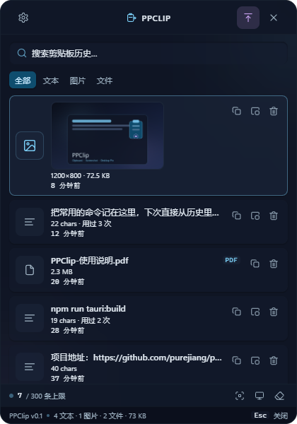

<p align="center">
  
</p>

<h1 align="center">PPClip</h1>

<p align="center">
  <b>Windows 剪贴板历史 · 截图 · 桌面贴图</b><br />
  复制过的文本、图片和文件自动收进历史；区域 / 全屏截图一键完成；需要时常驻的内容可以贴在桌面上。
</p>

<p align="center">
  简体中文 · <a href="README.en.md">English</a>
</p>

<p align="center">
  
  
  
  
  
</p>

<p align="center">
  
</p>

## 简介

PPClip 是一个常驻桌面的 Windows 小工具：一个悬浮球加一枚托盘图标，没有常驻主窗口。
单击悬浮球或托盘图标才会打开历史面板；复制的内容会按内容哈希去重后写入本地 SQLite，
截图的结果同样会写回剪贴板并进入历史。

数据全部保存在本机，不上传、不同步。应用默认不联网；仅当你点击「关于 → 检查更新」时，会请求 GitHub Releases 接口（api.github.com），只检查版本，不下载、不安装。

## 功能

- 📋 **剪贴板历史** —— 自动记录文本、图片和文件（资源管理器里复制的多个文件算一条）；重复复制只置顶、不新增；支持单条删除和清空全部
- 🔍 **搜索与筛选** —— 关键词搜索，按全部 / 文本 / 图片 / 文件筛选
- ✂️ **截图** —— 区域截图可拖出选区后继续微调，`Enter` / 双击确定、`Esc` / 右键取消；全屏截图覆盖光标所在显示器；结果自动进剪贴板和历史
- 🪄 **三态悬浮球** —— 贴边胶囊 ↔ 常规球 ↔ 快捷轮盘；拖到屏幕边自动吸附，鼠标离开自动滑回；有新内容时带角标
- 📌 **桌面贴图** —— 把文本或图片贴在桌面上，可拖动、滚轮缩放，重启后恢复位置和大小
- 👁️ **查看窗口** —— 单例，停在面板旁边；文本可选中复制，图片支持适应窗口 / 原始尺寸，文件显示格式、大小、修改时间和路径，可按需计算 SHA-256 与 MD5
- 🖥️ **面板置顶** —— 历史面板可以固定在最上层、点外部不收起；默认跟随普通窗口，失焦自动收回
- ⚙️ **设置** —— 历史条数（默认 300）、图片存储上限（默认 200 MB）、数据目录、悬浮球显隐与不透明度、面板不透明度、开机自启
- 🧩 **其他** —— 系统托盘、单实例（再次启动会唤回面板）、文件日志

## 使用

| 操作 | 说明 |
|---|---|
| 悬浮球 · 单击 | 打开 / 收起历史面板 |
| 悬浮球 · 拖动 | 移动位置；拖到屏幕边缘会吸附成胶囊 |
| 贴边胶囊 · 悬停 | 展开成常规球；在球上停留 2 秒展开快捷轮盘 |
| 托盘图标 | 左键开合面板，右键打开菜单 |
| 面板 · 单击条目 | 在右侧查看窗口打开详情 |
| 面板 · 行尾按钮 | 复制 / 贴到桌面 / 删除（删除需要点两次） |
| 面板 · 左上角 / 右上角 | 设置 / 桌面置顶、关闭面板 |
| 面板 · 键盘 | `↑` `↓` 选择 · `Enter` 详情 · `Ctrl+Enter` 复制 · `Esc` 收起 |
| 查看窗口 | 图片双击切换「适应窗口 / 原始尺寸」；`Esc` 返回 |
| 截图 | 拖出选区 → `Enter` 或双击确定；`Esc` / 右键取消 |
| 桌面贴图 | 滚轮缩放；右键菜单；右上角关闭 |

命令行截图（适合脚本调用）：

```powershell
ppclip.exe --capture-fullscreen
```

## 安装

**系统要求**：Windows 10 / 11（x64），WebView2 运行时（Windows 11 自带，Windows 10 通常也已随 Edge 安装）。

1. 打开 [Releases](https://github.com/purejiang/ppclip/releases) 下载最新的 `PPClip_x.y.z_x64-setup.exe`
2. 双击安装（NSIS，当前用户，无需管理员权限）
3. 启动后桌面会出现悬浮球，托盘也会出现 PPClip 图标

> 如果 Releases 里还没有安装包，可以按[从源码构建](#从源码构建)自行打包。

## 从源码构建

需要 Node.js 20.19+、Rust（MSVC 工具链）和 WebView2。

```bash
git clone https://github.com/purejiang/ppclip.git
cd ppclip
npm install

npm run tauri:dev     # 开发：Vite + Rust + 悬浮球
npm run tauri:build   # 打包：NSIS 安装器
```

打包产物在 `src-tauri/target/release/bundle/nsis/`。

其他命令：

```bash
npm run build         # 仅构建前端（tsc -b && vite build）
npm run lint          # oxlint
cd src-tauri && cargo test    # Rust 单元测试
cd src-tauri && cargo check   # Rust 类型检查
```

**开发提示**

- 直接运行 `cargo build` / `cargo check` 前需要先有 `dist/`（由 `npm run build` 生成），否则 `tauri::generate_context!` 会失败。
- `src-tauri/Cargo.toml` 中 `[profile.dev.package.libsqlite3-sys] debug = false` 不要删除：MSVC 带调试信息编译 SQLite 会报 D8050。
- 重新编译前先退出正在运行的 `ppclip.exe`，否则会遇到文件占用（os error 5）。

## 数据与隐私

所有数据只保存在本机，不上传、不同步。应用默认不联网、不后台联网；仅当你点击「检查更新」时，会请求 GitHub Releases 接口（api.github.com），请求不包含任何剪贴板内容，也不下载或安装任何东西。

默认位置：`%APPDATA%\com.purejiang.ppclip\`

| 路径 | 内容 |
|---|---|
| `ppclip.db` | SQLite 数据库（clips / pins） |
| `images/`、`thumbs/` | 图片原图与缩略图（文件名为内容 sha256） |
| `settings.json` | 历史上限、图片上限、窗口位置等设置 |
| `logs/ppclip.log` | 运行日志 |

## 技术栈

Tauri 2 · React 19 · TypeScript · Vite · Rust · rusqlite / SQLite

界面不依赖 UI 组件库和图标字体：样式是手写的 CSS 变量，图标是手写的 SVG 组件。

## 已知限制

- 没有全局热键：入口是悬浮球和托盘图标；隐藏悬浮球后，从托盘菜单召回。
- 托盘图标不显示新条目数量（角标只在悬浮球上）。
- 截图不支持标注、OCR、窗口截图和滚动长截图。
- 文件条目只能查看和复制，不能贴到桌面。
- 只记录纯文本、图片和文件列表，不保留富文本 / HTML 格式。
- 多显示器下，选区只在光标所在的那块屏幕内完成（混合 DPI 跨屏选区未支持）。
- 全屏独占应用（部分游戏、播放器）可能盖住悬浮球和桌面贴图。
- 检查更新需要联网；失败不影响任何本地功能。

## 贡献

欢迎提交 Issue 和 Pull Request。提交 PR 前建议先跑一遍 `npm run lint`、`npm run build` 和 `cd src-tauri && cargo test`。

版本迭代与 issue 工作流见 [docs/iteration/PPCLIP-ITERATION.md](docs/iteration/PPCLIP-ITERATION.md)；通用阶段复用 `.agents/skills`，PPClip 只保留 adapter 与三处增量。

更新日志见 [CHANGELOG.md](CHANGELOG.md)。

## License

MIT
